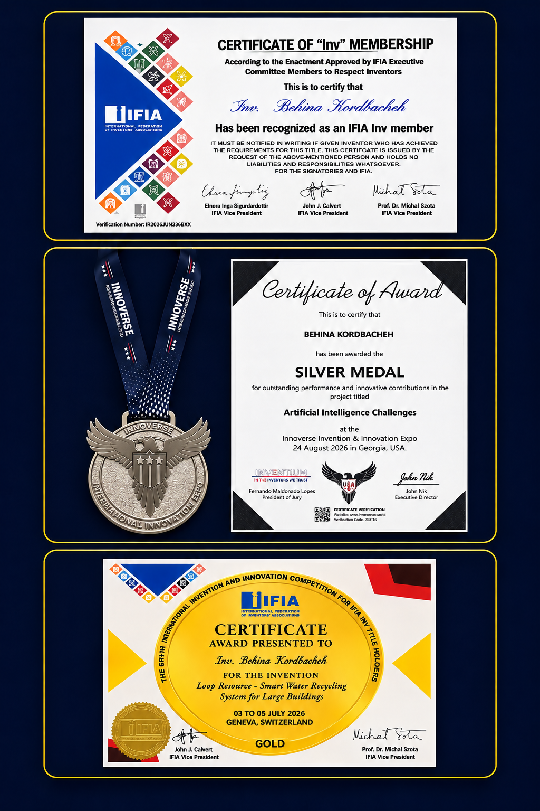

# Hi, I'm Behina Kordbacheh 👋

### Computer Engineering Student | AI & Machine Learning Enthusiast | Innovator

**Exploring artificial intelligence, engineering, and innovation to create meaningful solutions.**

---

## 👩🏻‍💻 About Me

I'm **Behina Kordbacheh**, a Computer Engineering student at the **University of Tehran**, passionate about artificial intelligence, machine learning, software development, and technology-driven innovation.

I enjoy combining programming, research, and creative problem-solving to explore solutions to real-world challenges.

- 🎓 Studying Computer Engineering
- 🤖 Interested in Artificial Intelligence & Machine Learning
- 🧠 Exploring intelligent systems and data-driven solutions
- 💻 Working with Python, C++, and software development tools
- 🌱 Interested in sustainable engineering and innovation
- 🚀 Continuously learning and developing new technical skills

---

## 🏆 Honors & International Recognition

  

### 🌍 IFIA Inventor Membership

**Recognized as an IFIA "Inv" Member**

International Federation of Inventors' Associations (IFIA)

Recognition under the IFIA inventor membership program.

### 🥈 Silver Medal — United States | 2026

**Innoverse Invention & Innovation Expo**

- Location: Georgia, USA
- Date: August 24, 2026
- Award: Silver Medal
- Category / Project Title: Artificial Intelligence Challenges

Recognized for innovative contributions in artificial intelligence.

### 🥇 Gold Medal — Switzerland | 2026

**6th International Invention and Innovation Competition for IFIA Inv Title Holders**

- Location: Geneva, Switzerland
- Date: July 3–5, 2026
- Award: Gold Medal
- Invention: Loop Resource — Smart Water Recycling System for Large Buildings

An innovation focused on recovering and reusing water resources in large buildings.

### 🍬 Candy Project

A creative project exploring programming and software development.

---

## 🚀 Featured Projects

### 🧠 Digital Wellness Analyzer

**AI-Powered Digital Behavior Analysis**

A machine learning project exploring patterns in digital behavior and screen-time habits.

**Key areas:**
- Digital behavior analysis
- Machine learning classification
- Feature engineering
- Data preprocessing
- Predictive modeling
- Personalized insights

**Technologies:** Python, Pandas, Scikit-learn, Machine Learning

#### 📊 Machine Learning Performance

| Model | Accuracy | ROC-AUC |
|---|---|---|
| Logistic Regression | 87.5% | 0.954 |
| Random Forest | 93.9% | 0.989 |

*Experimental results on a held-out test dataset.*

#### 🔬 Technical Highlights
- Analyzed 7,500 records of digital behavior data.
- Applied data preprocessing and feature engineering.
- Developed and compared machine learning classifiers.
- Evaluated predictive performance using multiple metrics.

### 💧 ResourceLoop — Smart Water Reuse System

**Sustainable Engineering & Smart Resource Management**

A proposed intelligent system designed to recover condensate water from HVAC and cooling systems for monitored, non-potable reuse in large facilities.

**Core concepts:**
- HVAC condensate water collection
- Water quality monitoring
- Smart filtration and disinfection
- Non-potable water reuse
- Resource consumption dashboards
- Peak energy demand monitoring

**Focus:** Sustainability, IoT, Smart Systems, Engineering Innovation

#### 💡 Innovation & Project Vision

ResourceLoop is a sustainable engineering concept focused on recovering and reusing condensate water generated by HVAC and air-conditioning systems in large buildings.

The project explores how smart monitoring and water management technologies could help reduce water waste and improve resource efficiency.

#### 🔬 Technical Concepts
- HVAC condensate collection and recovery
- Water quality monitoring
- Smart filtration and disinfection
- Non-potable water reuse
- Sensor-based monitoring and automation
- Resource efficiency and sustainability analysis
- Smart building integration

#### 🌍 Potential Applications
- Commercial buildings and office complexes
- Hotels and large residential facilities
- Smart buildings and sustainable infrastructure
- Water conservation systems

#### 🏆 International Recognition

**Gold Medal — Switzerland, 2026**

6th International Invention and Innovation Competition for IFIA Inv Title Holders

**Geneva, Switzerland | July 3–5, 2026**

Awarded for the invention:
**Loop Resource — Smart Water Recycling System for Large Buildings**

#### 🛠️ Engineering Focus
Sustainable Engineering • Smart Water Management • IoT Concepts • Environmental Innovation

### 🤖 Arduino & Embedded Systems Development

**Exploring Embedded Technologies, Microcontroller Programming & Intelligent Hardware Systems**

Actively developing practical skills in embedded systems, electronics, and microcontroller-based programming, with a focus on integrating software and hardware to create interactive and responsive systems.

My hands-on experience includes working with Arduino development platforms, electronic circuits, sensor-based applications, and programmable hardware components.

**Areas of Technical Focus:**
- Embedded Systems & Microcontroller Programming
- Hardware–Software Integration
- Sensor Interfacing & Data Acquisition
- Electronic Circuit Design & Prototyping
- Interactive Systems Development
- Arduino-Based Automation Concepts

**Technical Environment:** Arduino IDE | C/C++ | Microcontrollers | Electronic Prototyping

Continuously expanding my knowledge of embedded technologies, with a growing interest in intelligent hardware, automation, and real-world engineering applications.

---

## 🛠️ Tech Stack & Tools

### Programming Languages

### AI & Data Science

### Development & Engineering

---

## 📊 GitHub Statistics

---

## 🌐 Connect With Me

---

### ✨ Turning Ideas Into Impact

*Driven by curiosity. Inspired by innovation. Focused on meaningful technology.*

